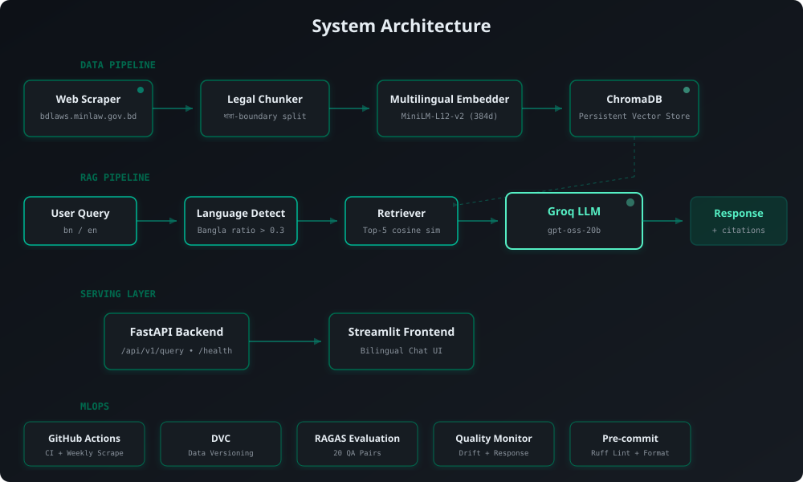
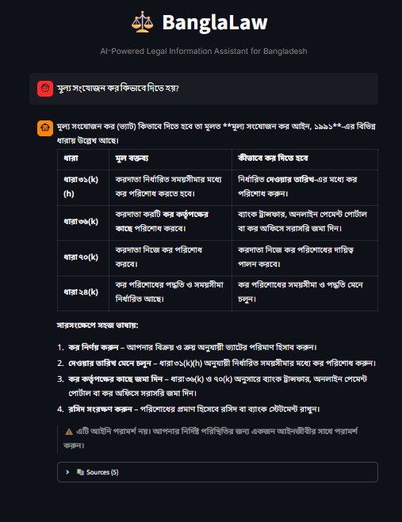
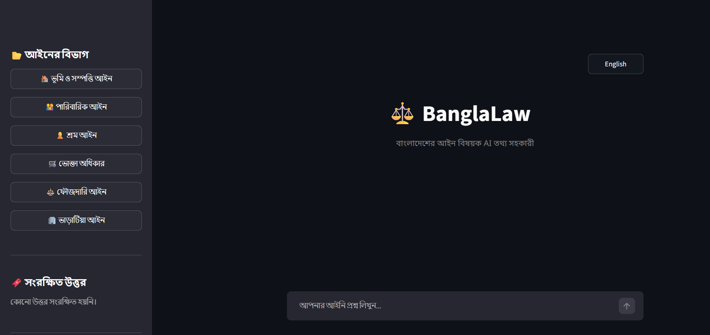

<p align="center">
  
</p>

<p align="center">
  <strong>AI-Powered Bangladeshi Legal Information Assistant</strong><br/>
  <em>বাংলাদেশের আইন সহজ ভাষায় — Bangladeshi Law in Simple Language</em>
</p>

<p align="center">
  
  
  
  
  
  
</p>

<p align="center">
  
  
  
  
</p>

---

## The Problem

Bangladesh has thousands of laws in Bangla, scattered across government websites in formats that are hard to search, harder to understand, and nearly impossible for ordinary citizens to navigate. Legal professionals spend hours hunting for relevant sections. Citizens often can't afford lawyers just to understand their basic rights.

**BanglaLaw AI** solves this by building a Retrieval-Augmented Generation (RAG) system that:
- Scrapes laws directly from [bdlaws.minlaw.gov.bd](http://bdlaws.minlaw.gov.bd) (the official source)
- Chunks them intelligently by legal section (ধারা) boundaries — not arbitrary token splits
- Embeds them using a multilingual model that understands both Bangla and English
- Answers legal questions with **exact law citations** (act name + section number)

---

## Architecture

<p align="center">
  
</p>

The system follows a modular pipeline architecture:

| Layer | Components | Purpose |
|-------|-----------|---------|
| **Data Pipeline** | Scraper → Chunker → Embedder → ChromaDB | Ingest laws from bdlaws.minlaw.gov.bd |
| **RAG Pipeline** | Language Detect → Retriever → Groq LLM → Response | Generate cited answers |
| **Serving** | FastAPI + Streamlit | REST API + Bilingual Chat UI |
| **MLOps** | GitHub Actions, DVC, RAGAS Eval, Quality Monitor | CI/CD, versioning, evaluation |

---

## Features

### Bilingual Legal Q&A
Ask questions in **Bangla** or **English** — the system auto-detects the language and responds in the same language. Bangla queries use Bangla font rendering; English queries get English responses.

### Intelligent Legal Chunking
Unlike generic RAG systems that split text by token count, BanglaLaw splits by **ধারা (section) boundaries** — the natural unit of Bangladeshi law. Sub-sections are handled with regex-based splitting for sections exceeding the size limit.

### Source Citations
Every answer includes the **exact law name and section number** it was derived from. No hallucinated references — citations come directly from the retrieval metadata.

### Confidence-Based Fallback
The system computes a weighted confidence score from retrieval results. When confidence drops below the threshold (0.25), it returns an honest "I don't have enough information" response instead of guessing.

### Cross-Lingual Retrieval
Uses `sentence-transformers/paraphrase-multilingual-MiniLM-L12-v2` (384-dimensional embeddings) which maps both Bangla and English into the same vector space, enabling cross-language search.

### Chat Interface with Context
The Streamlit frontend maintains conversation history, supports law category quick-access from the sidebar, and provides feedback buttons (👍👎) for response quality tracking.

### WhatsApp Sharing
Users can share answers directly via WhatsApp with a formatted text that includes the answer summary and source citations.

### Automated Data Pipeline
A GitHub Actions workflow runs weekly to re-scrape laws, detect changes via SHA-256 hash comparison, and auto-commit new data — keeping the legal corpus fresh.

### Full MLOps Stack
- **DVC** for data versioning (raw scraped data + processed chunks)
- **GitHub Actions** for CI (lint + test on every push) and scheduled scraping
- **RAGAS-compatible evaluation** with 20 curated QA pairs across 6 legal categories
- **Custom monitoring** for data drift detection and response quality tracking
- **Pre-commit hooks** with Ruff linting and formatting

---

## Working Demo

### Bangla Query — VAT Registration Cancellation Rules
<p align="center">
  
</p>

> **Query:** মূল্য সংযোজন কর আইনে নিবন্ধন বাতিলের নিয়ম কি?
>
> The system retrieves relevant sections from the মূল্য সংযোজন কর আইন (Value Added Tax Act) and generates a detailed answer in Bangla with exact section citations.

### Sidebar Category Navigation
<p align="center">
  
</p>

> Quick-access categories in the sidebar let users explore specific areas of law — Tenant Rights, Criminal Law, Family Law, Labor Law, Land Law, and Consumer Protection.

---

## Tech Stack

| Component | Technology | Why |
|-----------|-----------|-----|
| **Embeddings** | `paraphrase-multilingual-MiniLM-L12-v2` | Best open-source multilingual model for low-resource languages like Bangla |
| **Vector Store** | ChromaDB (persistent, cosine similarity) | Lightweight, no external server needed, ideal for legal document scale |
| **LLM** | Groq API (`openai/gpt-oss-20b`) | Fast inference, free tier available for development |
| **Backend** | FastAPI + Uvicorn | Async, auto-docs, production-grade Python API |
| **Frontend** | Streamlit | Rapid prototyping with native chat components |
| **Data Pipeline** | httpx + BeautifulSoup + tenacity | Async scraping with retry logic and rate limiting |
| **Data Versioning** | DVC | Git-like versioning for large data files |
| **CI/CD** | GitHub Actions | Automated testing, linting, and weekly scraping |
| **Code Quality** | Ruff + pre-commit | Fast linting and formatting on every commit |

---

## Project Structure

```
BanglaLaw-Ai-Legal-Assistant/
├── src/
│   ├── scraper/
│   │   ├── bdlaws_scraper.py     # Scrapes laws from bdlaws.minlaw.gov.bd
│   │   ├── change_detector.py    # SHA-256 hash-based change detection
│   │   └── run_scraper.py        # Entry point for scheduled scraping
│   ├── ingestion/
│   │   ├── chunker.py            # ধারা-boundary legal text chunking
│   │   ├── embedder.py           # Multilingual embedding wrapper
│   │   └── vectorstore.py        # ChromaDB persistent store operations
│   ├── rag/
│   │   ├── retriever.py          # Confidence-scored retrieval
│   │   ├── prompt_templates.py   # Bilingual system + QA prompts
│   │   └── chain.py              # Full RAG chain with language detection
│   ├── api/
│   │   ├── main.py               # FastAPI app factory with lifespan
│   │   ├── routes.py             # /health, /query, /feedback endpoints
│   │   ├── schemas.py            # Pydantic request/response models
│   │   └── middleware.py         # Rate limiting + request logging
│   ├── evaluation/
│   │   ├── qa_pairs.json         # 20 curated QA pairs (6 categories)
│   │   ├── metrics.py            # Citation hit, section hit, has_answer
│   │   └── evaluate.py           # Evaluation runner + results export
│   ├── monitoring/
│   │   ├── drift.py              # Data drift detection (20% threshold)
│   │   └── quality.py            # Response quality + feedback tracking
│   └── utils/
│       ├── config.py             # Pydantic Settings from .env
│       └── logger.py             # Loguru structured logging
├── frontend/
│   └── app.py                    # Streamlit bilingual chat interface
├── tests/                        # 55+ tests across all modules
├── .github/workflows/
│   ├── ci.yml                    # Lint + test on push/PR
│   └── scraper.yml               # Weekly automated scraping
├── pyproject.toml                # Project config, dependencies, ruff
├── .pre-commit-config.yaml       # Ruff hooks
└── .env.example                  # Required environment variables
```

---

## Evaluation

The system is evaluated against 20 hand-curated QA pairs spanning 6 legal categories:

| Category | QA Pairs | Metrics |
|----------|---------|---------|
| Tenant Rights (ভাড়াটিয়া আইন) | 4 | Citation hit, Section hit |
| Criminal Law (ফৌজদারি আইন) | 4 | Citation hit, Section hit |
| Family Law (পারিবারিক আইন) | 3 | Citation hit, Section hit |
| Labor Law (শ্রম আইন) | 3 | Citation hit, Section hit |
| Land Law (ভূমি আইন) | 3 | Citation hit, Section hit |
| Consumer Protection (ভোক্তা অধিকার) | 3 | Citation hit, Section hit |

Metrics tracked:
- **Citation Hit Rate** — Does the response cite a relevant law?
- **Section Hit Rate** — Does the cited section match the expected section?
- **Has Answer Rate** — Does the system provide a substantive answer vs. fallback?

---

## Known Limitations

### Corpus Coverage
The current deployment scrapes a **subset** of laws from bdlaws.minlaw.gov.bd — not the complete corpus of Bangladeshi legislation. A full scrape of all volumes would significantly improve coverage and answer quality.

### Cross-Lingual Retrieval Gap
While the multilingual embeddings enable cross-language search, **English queries against a Bangla-only corpus** produce lower confidence scores (typically 0.30–0.45) compared to Bangla queries (0.70–0.90). Scraping the English version of laws (`?lang=en`) would close this gap.

### Free-Tier LLM Constraints
The system currently uses `openai/gpt-oss-20b` on Groq's free tier — a smaller model than originally planned (Llama 3.1 70B, which was deprecated). This affects answer depth and nuance, particularly for complex multi-section legal questions.

### Not Legal Advice
This is an **information retrieval tool**, not a substitute for professional legal counsel. Answers are generated from statute text and may not reflect judicial interpretations, amendments not yet published, or the specific circumstances of any case.

### No Authentication
The current version has no user authentication — it uses in-memory rate limiting per IP address. A production deployment would need proper auth and persistent rate limiting.

### Single Language per Query
The system detects language per query and responds in that language. It does not support mixed-language queries (e.g., "আমি জানতে চাই about tenant rights") — it will pick one language based on the Bangla character ratio.

---

## Acknowledgments

- **[bdlaws.minlaw.gov.bd](http://bdlaws.minlaw.gov.bd)** — Ministry of Law, Government of Bangladesh, for the official law database
- **[Sentence Transformers](https://www.sbert.net/)** — For the multilingual MiniLM model
- **[Groq](https://groq.com/)** — For fast LLM inference API
- **[ChromaDB](https://www.trychroma.com/)** — For the vector store
- **[LangChain](https://python.langchain.com/)** — For LLM chain abstraction

---

<p align="center">
  
</p>

<p align="center">
  <em>Built as a production-grade RAG + MLOps portfolio project demonstrating end-to-end ML engineering with a focus on low-resource language (Bangla) retrieval.</em>
</p>
